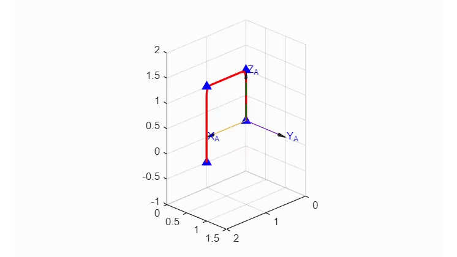
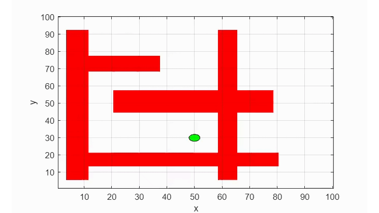
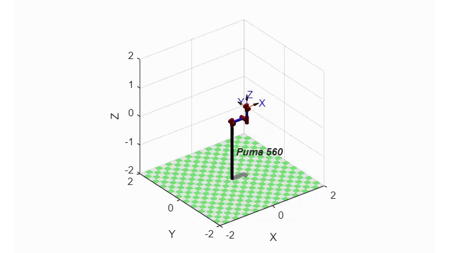
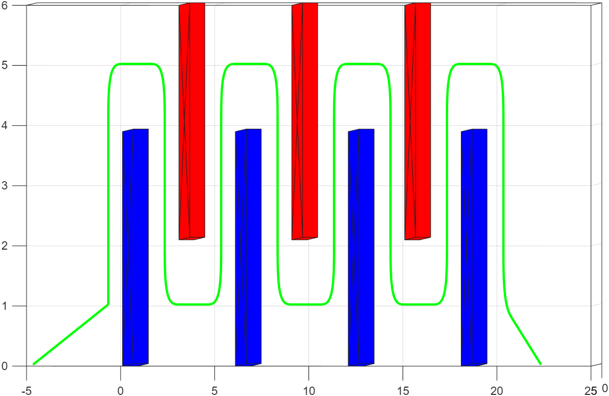
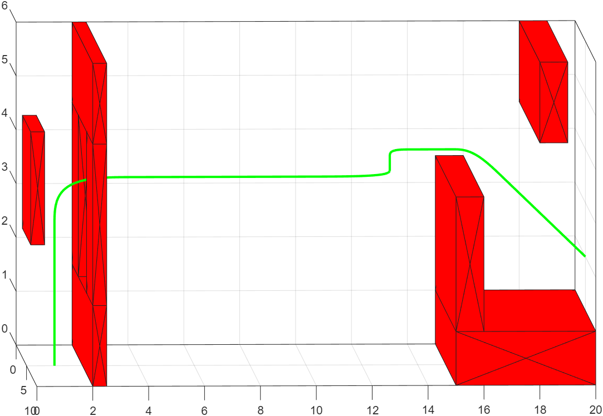
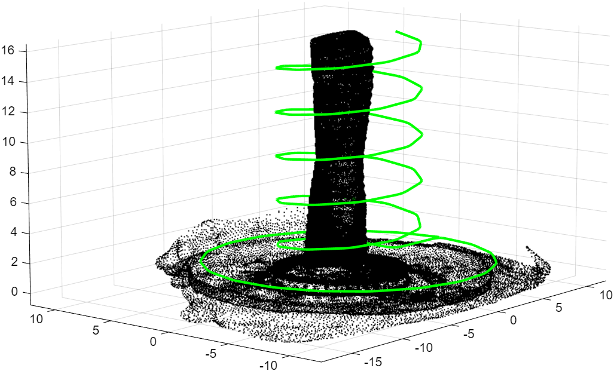
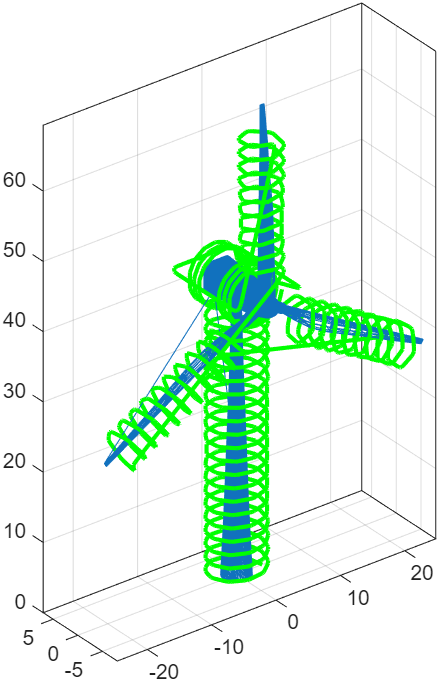

# Laboratory 1 Time and Motion 

Author/ Group Members: Yelizaveta Radkavets Date: 11.11.2026 

## Objective: 

- Learn the concept of frames and transformations from one frame to enother 

- Make transformations smooth 

- Move points of trajectory in the space 

- Generate points of trajectory 

### Methodology: 

#### **Task 1** 

Function _mstraj()_ is used to create smooth transitions between points. This function is also used to create smooth rotation. 

*Rotation transition*

On animation there is the path and we can see that stransition between points is smooth. 

TRAJ = **mstraj** (WP, QDMAX, TSEG, Q0, DT, TACC, OPTIONS) 

- WP (MxN) is a matrix of via points, 1 row per via point, one column 

- per axis.  The last via point is the destination. 

- QDMAX (1xN) are axis speed limits which cannot be exceeded, 

- TSEG (1xM) are the durations for each of the K segments 

- Q0 (1xN) are the initial axis coordinates 

- DT is the time step 

- TACC (1x1) is the acceleration time used for all segment transitions 

We cannot use both QDMAX and TSEG, only one of this parameters, and the second leave empty []. 

#### **Task 2** 

*Car trajectory*

In this task path is defined by the points 

#### **Task 3** 

Trajectory is defined by points. To stop drawing and move to another later, pen should move up from the wall(change in x coordinates). Every later is different trajectory. Then combined in one matrix of position vectors . To rotate trajectory i used rotation matrix 

*Wall painter*

<mark>R=roty(10, 'deg')
path=path*R;</mark> 

*Wall painter inclined*

#### **Task 4** 

Path 1 

In this task the map has predefined repeatable shape, so I created function that generates oins of the path and then used it in mstraj() function to generate path. 

<mark>function path=generate_path(init,n_steps,delta)
    path=[init]
    for i=1:2:n_steps*2
        i
        path = [path;init+[(i-1)*delta, 0, 0]; init + [(i-1)*delta, 0, 4];init + [(i)*delta, 0, 4];init + [(i)*delta, 0, 0];];
    end
end</mark> 

*Track 1*

Path 2 

Just defined by points and make smooth with mstraj() 

*Track 2*

Path 3 

X and Y coordinates are generated via sin() and cos of theta array of angles (linspace), radius and coordinates of center . Z is just higher in every step (linspace). 

*Fontain scan path*

Path 4 

- I predefined function that generates spiral and allows to rotate spital with rotation matric. 

<mark>function path=gen_spiral( radius, turns,height,n,C,R_a)

    R = rpy2r(R_a(1),R_a(2),R_a(3));
    theta = linspace(0, turns * 2 * pi, n)'; % Generate angles for every via point (step)
    z = linspace(0, height,n)'; % Generate height for every via point (step)
    points = [ radius*cos(theta),+ radius*sin(theta), z];
    path=(R * points')' + C;
   
end</mark> 

then I used this spirals and some linear transitions to create the path around object 

*Wind station*

### Results: 

With mstraj() we can create smooth transitions between poses, we can automate defining poses using some math equations. Defining path with maths equation is very convinient, and same shape can be deformed with rotation matrixes to folow more complicated shapes. 

